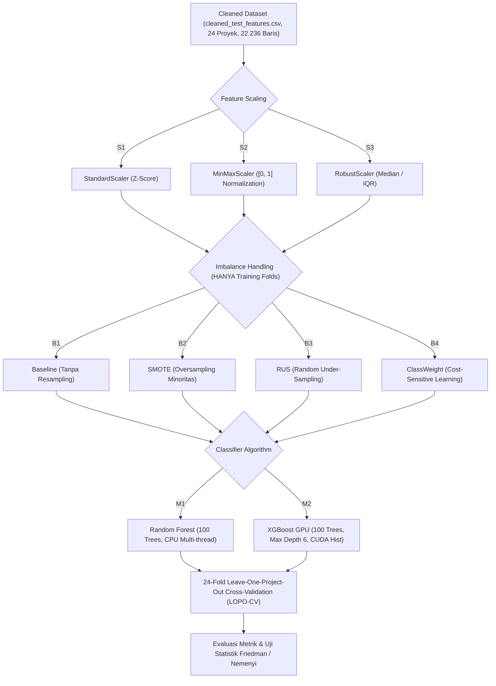

# 🔬 Rancangan Penelitian: Eksperimen 2 — Predicting Flaky Test in Cross-Project Scenario Menggunakan Dataset Terimputasi Bersih

**Kelompok Peneliti**: Kelompok A01 — Rekayasa Perangkat Lunak A (Magister Teknik Informatika ITS)  
**Dokumen Disimpan Pada**: `Eksperimen_Bima/Eksperiment-2/RANCANGAN_PENELITIAN_EKSPERIMEN_2.md`  
**Dataset Utama**: `Experiment_Ali/data/cleaned_test_features.csv`  
**Hubungan dengan Eksperimen 1**: Penyempurnaan dan studi komparatif langsung terhadap temuan pada `Eksperimen_Bima/Eksperimen-1/`.  
**Paper Rujukan Utama**:
1. Alshammari et al. (ICSE 2021) — *FlakeFlagger: Predicting Flakiness Without Rerunning Tests*
2. Afeltra et al. (IEEE Access 2024) — *A Large-Scale Empirical Investigation Into Cross-Project Flaky Test Prediction*
3. Pontillo et al. (EMSE 2022) — *Static Test Flakiness Prediction: How Far Can We Go?*

---

## 📑 Daftar Isi
1. [Ringkasan Eksekutif & Rasional Transisi](#1-ringkasan-eksekutif--rasional-transisi)
2. [Analisis Kritis Transisi: Dari Eksperimen 1 ke Eksperimen 2](#2-analisis-kritis-transisi-dari-eksperimen-1-ke-eksperimen-2)
3. [Karakteristik Dataset `cleaned_test_features.csv`](#3-karakteristik-dataset-cleaned_test_featurescsv)
4. [Desain Faktorial 24 Pipelines Eksperimen 2](#4-desain-faktorial-24-pipelines-eksperimen-2)
5. [Skema Validasi Leave-One-Project-Out Cross-Validation (LOPO-CV)](#5-skema-validasi-leave-one-project-out-cross-validation-lopo-cv)
6. [Rumusan Masalah & Research Questions (RQ)](#6-rumusan-masalah--research-questions-rq)
7. [Metrik Evaluasi & Uji Signifikansi Statistik](#7-metrik-evaluasi--uji-signifikansi-statistik)
8. [Rencana Analisis Komparatif Silang (Eksperimen 1 vs Eksperimen 2)](#8-rencana-analisis-komparatif-silang-eksperimen-1-vs-eksperimen-2)

---

## 1. Ringkasan Eksekutif & Rasional Transisi

Pada Eksperimen 1, penelitian berfokus pada evaluasi skenario *Leave-One-Project-Out Cross-Validation (LOPO-CV)* lintas 24 proyek Java FlakeFlagger dengan membandingkan dua strategi penanganan *missing values*:
- **C1 (Row-Level Drop)**: Menghapus 273 baris data yang mengandung NaN pada kolom `testLength`, `numAsserts`, atau `numCoveredLines` (mempertahankan 24 proyek, 21.963 baris).
- **C2 (Project-Level Drop)**: Menghapus seluruh 5 proyek yang terdampak missing value (`wildfly`, `logback`, `spring-boot`, `wro4j`, `handlebars.java`), menyisakan 19 proyek (16.458 baris).

### Temuan Kunci Eksperimen 1:
Meskipun C2 menghasilkan metrik rata-rata lebih tinggi di atas kertas (Mean PR-AUC: 0.2356 vs 0.1912), **C2 memotong 222 flaky test riil (~27% dari seluruh flaky test)**. Salah satu proyek yang dibuang adalah `spring-boot`, yang menyumbang **163 flaky test (20% dari seluruh flaky test di dataset)**. Membuang proyek berskala besar tersebut melemahkan transferability model ke arsitektur perangkat lunak enterprise.

### Rasional Eksperimen 2:
Ali telah melakukan prapemrosesan lanjutan pada `Experiment_Ali/data/cleaned_test_features.csv` dengan menerapkan *Group-Aware Per-Project Median & Probabilistic Imputation*. Melalui teknik ini:
1. **Seluruh 273 nilai hilang berhasil diimputasi** tanpa membuang satu pun baris data.
2. **Seluruh 24 proyek open-source Java tetap utuh**, menjaga keanekaragaman representasi domain.
3. **Seluruh 811 flaky test (100%) terlestarikan**, memastikan model mendapatkan sinyal pelatihan minoritas yang maksimal.

Dengan demikian, **faktor manipulasi cleaning C1 vs C2 gugur / tidak lagi diperlukan**. Eksperimen 2 menyusun ulang matriks eksperimen menjadi **24 Pipelines Faktorial** ($3 \text{ Scaling} \times 4 \text{ Imbalance} \times 2 \text{ Model}$) pada ke-24 proyek utuh, menciptakan platform pengujian yang sepenuhnya bersih, adil, dan representatif.

---

## 2. Analisis Kritis Transisi: Dari Eksperimen 1 ke Eksperimen 2

| Dimensi Perbandingan | Eksperimen 1 (Raw Dataset) | Eksperimen 2 (Cleaned Imputed Dataset) | Implikasi Ilmiah |
|---|---|---|---|
| **Sumber Data** | `test_features.csv` (Raw) | `Experiment_Ali/data/cleaned_test_features.csv` | Dataset Eksperimen 2 telah terstandardisasi dan bebas NaN. |
| **Penanganan Missing Values** | C1 (Hapus baris) vs C2 (Hapus proyek) | *Group-Aware Per-Project Median Imputation* | Tidak ada informasi atau instance yang dibuang sia-sia. |
| **Jumlah Baris Data** | C1: 21.963 baris C2: 16.458 baris | **22.236 baris (100% Utuh)** | Data latih dan uji memiliki sampel maksimum. |
| **Jumlah Proyek Java** | C1: 24 proyek C2: 19 proyek | **24 proyek (100% Utuh)** | Lipatan LOPO-CV selalu berjumlah 24 Folds konstan. |
| **Populasi Flaky Test** | C1: 808 flaky C2: 586 flaky (-27%) | **811 flaky (100% Utuh)** | Proyek kunci `spring-boot` (163 flaky) & `wildfly` aktif penuh. |
| **Jumlah Pipeline** | 48 Pipeline ($2 \times 3 \times 4 \times 2$) | **24 Pipeline ($1 \times 3 \times 4 \times 2$)** | Eksperimen lebih terfokus, efisien, dan tajam. |
| **Total Model Folds** | 1.032 model evaluasi | **576 model evaluasi ($24 \times 24$)** | Mengurangi beban komputasi ~44% dengan kualitas data lebih tinggi. |

---

## 3. Karakteristik Dataset `cleaned_test_features.csv`

### 3.1 Ringkasan Data
- **Total Baris**: 22.236 test cases
- **Total Proyek**: 24 repositori open-source Java
- **Missing Values**: 0 (Nol mutlak di seluruh kolom)
- **Distribusi Kelas**:
  - Non-Flaky ($y = 0$): 21.425 test cases (96,35%)
  - Flaky ($y = 1$): 811 test cases (3,65%)
  - Rasio Ketimpangan: $\approx 1 : 26.4$ (Sangat Imbalanced)

### 3.2 Pembagian Fitur
Dari total 29 kolom:
1. **5 Kolom Identifikasi Metadata** (*Wajib Dikeluarkan dari Matriks Fitur $X$*):
   `Unnamed: 0`, `test_name`, `project`, `testClassName`, `testMethodName`.
2. **1 Kolom Target**: `flaky` (0 atau 1).
3. **23 Fitur Prediktif ($X$)**:
   - **8 Test Smell (Binary 0/1)**:
     `assertion-roulette`, `conditional-test-logic`, `eager-test`, `fire-and-forget`, `indirect-testing`, `mystery-guest`, `resource-optimism`, `test-run-war`.
   - **7 Test Execution, Coverage & Dependency (Numerik)**:
     `testLength`, `numAsserts`, `numCoveredLines`, `ExecutionTime`, `projectSourceLinesCovered`, `projectSourceClassesCovered`, `num_third_party_libs`.
   - **8 Code Churn H-Index (Numerik)**:
     `hIndexModificationsPerCoveredLine_window5`, `window10`, `window25`, `window50`, `window75`, `window100`, `window500`, `window10000`.

---

## 4. Desain Faktorial 24 Pipelines Eksperimen 2

Matriks faktorial Eksperimen 2 disusun dari 3 variabel bebas utama:

### Rincian 24 Konfigurasi Pipeline:
- **P01 s.d P08**: Scaler `S1` (StandardScaler) $\times$ {`B1`, `B2`, `B3`, `B4`} $\times$ {`M1`, `M2`}
- **P09 s.d P16**: Scaler `S2` (MinMaxScaler) $\times$ {`B1`, `B2`, `B3`, `B4`} $\times$ {`M1`, `M2`}
- **P17 s.d P24**: Scaler `S3` (RobustScaler) $\times$ {`B1`, `B2`, `B3`, `B4`} $\times$ {`M1`, `M2`}

### Protokol Ketat: Zero Data Leakage
- **Feature Scaling**: Scaler (`S1`, `S2`, `S3`) di-`fit` **HANYA** pada fold data latih ($N-1 = 23$ proyek), lalu diterapkan (`transform`) pada data latih dan data uji ($1$ target proyek).
- **Resampling**: SMOTE (`B2`) dan RUS (`B3`) dioperasikan **HANYA** pada matriks data latih. Data uji target dibiarkan pada distribusi alaminya.

---

## 5. Skema Validasi Leave-One-Project-Out Cross-Validation (LOPO-CV)

- Evaluasi dilakukan secara berulang sebanyak **24 Folds**:
  Pada setiap fold $i \in \{1, 2, \dots, 24\}$, 1 proyek dijadikan unseen target test set, sedangkan 23 proyek lainnya digabungkan menjadi source training set.
- **Kasus Khusus `jimfs`**:
  Proyek `jimfs` memiliki 212 baris test case dan **0 flaky test**. Pada fold ini, PR-AUC dan ROC-AUC tidak dapat dihitung secara matematis. Engine kalkulasi mengeksekusi penanganan aman (mengisi `np.nan` untuk AUC, mencatat TN, FP, dan Specificity), serta memastikan script tidak berhenti mendadak (*graceful error handling*).
- **Preservasi Proyek Kunci**:
  Proyek `spring-boot` (163 flaky) dan `wildfly` (206 baris terimputasi) diuji dalam kapasitas penuh.

---

## 6. Rumusan Masalah & Research Questions (RQ)

### 🔹 RQ1: Dampak Imputasi Cerdas vs Strategi Pembuangan Data (C1 vs C2)
> *Bagaimana dampak pelestarian seluruh 24 proyek dan 811 flaky test melalui Group-Aware Median Imputation terhadap kemampuan generalisasi model lintas proyek jika dibandingkan dengan Row-Level Drop (C1) dan Project-Level Drop (C2) pada Eksperimen 1?*
- **Hipotesis**: Kehadiran proyek heterogen skala besar seperti `spring-boot` dan `wildfly` secara utuh akan meningkatkan keragaman pola fitur di ruang latih, menghasilkan model yang lebih adaptif dan meningkatkan stabilitas prediksi lintas proyek.

### 🔹 RQ2: Pengaruh Penskalaan Fitur (S1 vs S2 vs S3) pada Data Terimputasi
> *Di antara Standardization (S1), Normalization (S2), dan Robust Scaler (S3), teknik penskalaan manakah yang memberikan performa tertinggi dalam meredam domain shift ketika diaplikasikan pada dataset yang telah diimputasi?*
- **Hipotesis**: Karena imputasi berbasis median tidak mendistorsi distribusi interkuartil, `RobustScaler` (S3) dan `MinMaxScaler` (S2) diprediksi memberikan batas nilai yang lebih stabil bagi pohon keputusan dibanding `StandardScaler` (S1).

### 🔹 RQ3: Ketahanan Strategi Penanganan Ketimpangan Kelas (B1 vs B2 vs B3 vs B4)
> *Apakah Random Under-Sampling (B3: RUS) tetap menjadi strategi terbaik secara konsisten dalam memaksimalkan F1-Score dan Recall pada dataset terimputasi, melampaui SMOTE (B2), Class Weight (B4), dan Baseline (B1)?*
- **Hipotesis**: Ya, RUS akan tetap mendominasi karena pada skenario cross-project, pembuangan contoh mayoritas yang redundan di domain sumber mencegah model terdistorsi oleh pola lokal proyek sumber, sedangkan SMOTE berisiko menghasilkan instance sintetis yang tidak valid bagi domain target.

### 🔹 RQ4: Evaluasi Komparatif Algoritma Klasifikasi (M1: RF vs M2: XGBoost)
> *Apakah XGBoost dengan akselerasi GPU tetap mengungguli Random Forest dalam metrik operasional nyata (F1-Score, Recall, Precision, MCC) pada dataset terimputasi penuh?*
- **Hipotesis**: XGBoost tetap unggul secara signifikan karena mekanisme regularisasi L1/L2 dan pemotongan pohon berbasis histogram (`hist`) meminimalkan overfitting terhadap varians lokal antar proyek.

---

## 7. Metrik Evaluasi & Uji Signifikansi Statistik

### 7.1 Metrik Kinerja (Fokus Imbalanced Cross-Project)
1. **PR-AUC (Precision-Recall Area Under Curve / Average Precision)** — Metrik primer perankingan probabilitas pada data imbalanced.
2. **F1-Score (Flaky Class)** — Harmonik rata-rata presisi dan recall kelas flaky (threshold $0.5$).
3. **Recall (Flaky)** — Persentase test flaky yang berhasil tertangkap.
4. **Precision (Flaky)** — Tingkat ketepatan sinyal peringatan flaky test.
5. **MCC (Matthews Correlation Coefficient)** — Korelasi biner seimbang.
6. **ROC-AUC** — Kemampuan diskriminasi umum model.
7. **Balanced Accuracy** — Rata-rata akurasi sensitivitas dan spesifisitas.
8. **Elemen Confusion Matrix**: TP, FP, TN, FN.

### 7.2 Standar Empiris Statistik (*ACM/SIGSOFT Standards*)
1. **Friedman Test**: Uji non-parametrik omnibus untuk menguji signifikansi perbedaan performa ke-24 pipeline di seluruh 24 lipatan proyek target ($\alpha = 0.05$).
2. **Nemenyi Post-hoc Test & Critical Difference (CD)**: Menghitung peringkat rata-rata (*average ranks*) seluruh pipeline dan menentukan klaster pipeline terbaik secara statistik.

---

## 8. Rencana Analisis Komparatif Silang (Eksperimen 1 vs Eksperimen 2)

Setelah eksekusi Eksperimen 2 rampung, akan disusun laporan komparatif silang (*Cross-Experiment Comparative Report*):
1. **Tabel Tiga Arah (Tri-Comparative Table)**:
   Membandingkan metrik terbaik dari:
   - Skenario C1 (Eksperimen 1: Row Drop, 24 Proyek, 21.963 baris)
   - Skenario C2 (Eksperimen 1: Project Drop, 19 Proyek, 16.458 baris)
   - Skenario Cleaned Imputed (Eksperimen 2: Group-Aware Median, 24 Proyek, 22.236 baris)
2. **Uji Delta Performa**: Mengukur kenaikan/penurunan kuantitatif F1-Score, Recall, Precision, dan PR-AUC akibat pelestarian data via imputasi.
3. **Sintesis Akademik**: Menghasilkan rekomendasi definitif bagi komunitas rekayasa perangkat lunak mengenai strategi pembersihan data paling efektif untuk riset deteksi flaky test lintas proyek.
