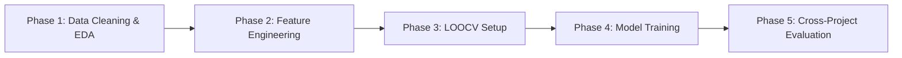

# 🧪 Predicting Flaky Test in Cross-Project Scenario

> **Penelitian Eksperimen**: Memprediksi *Flaky Test* menggunakan pendekatan Machine Learning secara *Project-Agnostic* pada skenario lintas proyek (*Cross-Project Scenario*).
> 
> Dataset berasal dari riset **FlakeFlagger**: *Predicting Flakiness Without Rerunning Tests* (Alshammari et al., ICSE 2021).

---

## 📌 1. Ikhtisar Penelitian

*Flaky test* adalah test case yang menunjukkan hasil yang tidak konsisten (kadang lolos, kadang gagal) pada versi kode yang sama tanpa ada perubahan. Deteksi flaky test tradisional membutuhkan eksekusi berulang (*rerunning*) hingga ribuan kali yang memakan waktu dan sumber daya tinggi.

Penelitian ini bertujuan untuk:
1. **Prediksi Tanpa Rerun**: Memprediksi flakiness berdasarkan atribut static & dynamic test (Test Smells, Test Metrics, Coverage, Code Churn, Dependency) tanpa melakukan rerun.
2. **Skenario Cross-Project (Project-Agnostic)**: Melatih model pada sekumpulan proyek dan mengujinya pada proyek baru yang belum pernah dilihat (*unseen project*), dengan mengeklusi fitur-fitur spesifik identitas proyek.

---

## 📁 2. Deskripsi Struktur Direktori

Berikut adalah struktur direktori proyek beserta fungsi dari masing-masing folder dan filenya:

```
Experiment_Ali/
├── 📁 data/                 # Folder berisi dataset mentah & hasil pemrosesan
│   ├── test_features.csv            # Dataset mentah (22.236 baris, 29 kolom: 22 fitur prediktif)
│   ├── test_results.csv             # Detail statistik rerun 10.000x per test case (22.245 baris)
│   ├── cleaned_test_features.csv    # Dataset hasil pembersihan & imputasi (Phase 1, 29 kolom)
│   ├── engineered_test_features.csv # Dataset hasil feature engineering (Phase 2, 58 kolom)
│   ├── validation_splits_metadata.json # Metadata konfigurasi split LOOCV & 70/30 (Phase 3)
│   ├── loocv_folds_summary.csv      # Ringkasan statistik 24 fold LOOCV (Phase 3)
│   ├── model_comparison_results.csv # Hasil perbandingan 7 model ML (Phase 4)
│   ├── loocv_lgbm_results.csv       # Hasil evaluasi 24 Fold LOOCV LightGBM (Phase 4)
│   ├── global_feature_importance.csv# Skor feature importance global (Phase 5)
│   └── README.md                    # Dokumentasi lengkap skema & penjelasan fitur dataset
│
├── 📁 notebook/             # Folder berisi Jupyter Notebooks & dokumen analisa
│   ├── 01_eda_and_feature_inspection.ipynb  # Phase 1: Cleaning, Imputasi & EDA per Proyek
│   ├── 02_feature_engineering_scaling.ipynb # Phase 2: Fitur Rasio, Log Transform, Scaling & PCA
│   ├── 03_validation_setup_loocv.ipynb      # Phase 3: Setup LOOCV 24-Fold & Multi-Project Split
│   ├── 04_model_training_and_imbalance.ipynb# Phase 4: Training, Imbalance & Threshold Tuning
│   ├── 05_evaluation_and_interpretability.ipynb # Phase 5: Evaluasi Komprehensif & Feature Importance
│   └── todo_analyze.md              # Dokumen analisa posibilitas & roadmap 5-phase eksperimen
│
├── 📁 script/               # Folder berisi script Python pembantu & otomatisasi
│   ├── build_full_notebook.py       # Script untuk membuat & mengompilasi Notebook Phase 1
│   ├── build_phase2_notebook.py     # Script untuk membuat & mengompilasi Notebook Phase 2
│   ├── build_phase3_notebook.py     # Script untuk membuat & mengompilasi Notebook Phase 3
│   ├── build_phase4_notebook.py     # Script untuk membuat & mengompilasi Notebook Phase 4
│   ├── build_phase5_notebook.py     # Script untuk membuat & mengompilasi Notebook Phase 5
│   └── generate_notebook.py         # Script pembantu template notebook
│
├── 📄 result.md             # Laporan lengkap rincian hasil implementasi Phase 1 s.d. 5
└── 📄 README.md             # Dokumen utama ini (Rekapitulasi proyek & struktur)
```

---

## 📑 3. Detail Setiap Direktori

### 3.1 📂 `data/`
Folder ini merupakan repositori data eksperimen.
- **`test_features.csv`**: File dataset mentah yang diekstraksi oleh FlakeFlagger, berisi 22.236 test case dari 24 proyek Java open-source (29 kolom, 22 fitur prediktif).
- **`test_results.csv`**: File log hasil eksekusi 10.000 kali rerun untuk setiap test case (22.245 baris), mencatat jumlah gagal, lolos, dan tipe exception.
- **`cleaned_test_features.csv`**: Dataset hasil **Phase 1** di mana missing values (273 baris) pada `testLength`, `numAsserts`, dan `numCoveredLines` telah diimputasi menggunakan *Group-Aware Median & Probabilistic Imputation* (22.236 baris, 29 kolom, 0 missing).
- **`engineered_test_features.csv`**: Dataset hasil **Phase 2** yang berisi 29 kolom asal + 29 kolom turunan (fitur rasio, `log1p` transform, versi `StandardScaler`/`RobustScaler`, dan 3 komponen PCA `hIndex`) → total **58 kolom**.
- **`validation_splits_metadata.json`**: File JSON hasil **Phase 3** berisi konfigurasi pemisahan indeks data untuk skema 24-fold LOOCV dan Multi-Project Split (70/30).
- **`loocv_folds_summary.csv`**: Tabel statistik hasil **Phase 3** yang merinci ukuran train/test set dan persentase flaky test di setiap fold.
- **`model_comparison_results.csv`**: Hasil evaluasi **Phase 4** membandingkan 7 model klasifikasi (Dummy, Logistic Regression, GaussianNB, Random Forest, XGBoost, LightGBM, CatBoost) pada skenario 70/30.
- **`loocv_lgbm_results.csv`**: Hasil evaluasi **Phase 4** untuk 24 Fold LOOCV menggunakan LightGBM Cost-Sensitive.
- **`global_feature_importance.csv`**: Skor kontribusi fitur global hasil **Phase 5** yang dihitung dari model LightGBM.
- **`README.md`**: Panduan komprehensif mengenai definisi 22 fitur (Test Smell, Metrics, Coverage, H-Index Churn, dan Dependency) serta hubungan antar fitur.

### 3.2 📂 `notebook/`
Folder ini berisi lembar kerja interaktif untuk eksplorasi data, pemodelan, dan evaluasi.
- **`01_eda_and_feature_inspection.ipynb`**: Notebook eksekusi Phase 1 yang mencakup pemisahan matriks fitur $X$ dan metadata, imputasi missing values, analisis ketimpangan kelas target per proyek, inspeksi *domain shift* (skala fitur), dan korelasi antar fitur.
- **`02_feature_engineering_scaling.ipynb`**: Notebook eksekusi Phase 2 yang mencakup pembuatan fitur rasio *project-agnostic*, log transformation fitur skewed, perbandingan `StandardScaler` vs `RobustScaler`, reduksi multikolinearitas 8 window `hIndex` via PCA, serta ekspor `data/engineered_test_features.csv`.
- **`03_validation_setup_loocv.ipynb`**: Notebook eksekusi Phase 3 yang mencakup implementasi skema Leave-One-Project-Out Cross-Validation (LOOCV / LOPO-CV) 24-fold, verifikasi pencegahan *data leakage*, visualisasi distribusi fold, skenario Multi-Project Split (70/30), dan ekspor metadata validasi.
- **`04_model_training_and_imbalance.ipynb`**: Notebook eksekusi Phase 4 yang mencakup pelatihan 7 model baseline & ensemble, penanganan class imbalance (Cost-Sensitive & SMOTE), optimal threshold tuning, dan eksekusi 24 fold LOOCV.
- **`05_evaluation_and_interpretability.ipynb`**: Notebook eksekusi Phase 5 yang menyajikan sintesis evaluasi metrik, perbandingan model, analisis mendalam performa per proyek target, dan visualisasi feature importance.
- **`todo_analyze.md`**: Dokumen analisis kelayakan (*feasibility study*) rencana *project-agnostic prediction*, tantangan utama (domain shift, class imbalance, multikolinearitas), serta strategi penanganannya.

### 3.3 📂 `script/`
Folder ini menyimpan kode Python modular untuk mengotomatisasi pemrosesan data dan pembuatan notebook secara sistematis.
- **`build_full_notebook.py`**: Membangun dan mengkompilasi notebook `01_eda_and_feature_inspection.ipynb` secara terstruktur dengan visualisasi dan output yang terisi.
- **`build_phase2_notebook.py`**: Membangun dan mengkompilasi notebook `02_feature_engineering_scaling.ipynb` (Phase 2) beserta output dataset engineered.
- **`build_phase3_notebook.py`**: Membangun dan mengkompilasi notebook `03_validation_setup_loocv.ipynb` (Phase 3) beserta output metadata split.
- **`build_phase4_notebook.py`**: Membangun dan mengkompilasi notebook `04_model_training_and_imbalance.ipynb` (Phase 4).
- **`build_phase5_notebook.py`**: Membangun dan mengkompilasi notebook `05_evaluation_and_interpretability.ipynb` (Phase 5).
- **`generate_notebook.py`**: Script pembantu berisi template mentah notebook Phase 1 (versi tanpa output terisi).

---

## 🚀 4. Roadmap Eksperimen (5-Phase Roadmap)

Penelitian ini dijalankan secara bertahap mengikuti 5 fase utama:



1. ✅ **Phase 1: Data Preparation, Imputation & Inspection** *(Selesai)*
   - Pemisahan metadata vs matriks fitur $X$.
   - Imputasi *group-aware probabilistic/median* pada 273 missing values.
   - Analisis deskriptif skala & distribusi flaky test per proyek.
2. ✅ **Phase 2: Feature Engineering & Normalization** *(Selesai)*
   - Pembuatan fitur rasio ($\text{coverage\_ratio}$, $\text{assert\_density}$, $\text{class\_coverage\_ratio}$).
   - Log transformation ($\log(x+1)$) untuk fitur berdistribusi skewed.
   - Normalisasi `StandardScaler` dan `RobustScaler` untuk mitigasi *domain shift*.
   - Kompresi PCA pada 8 window `hIndex` untuk eliminasi multikolinearitas.
3. ✅ **Phase 3: Validation Strategy Setup (Leave-One-Project-Out / LOOCV)** *(Selesai)*
   - Menyusun skema LOOCV 24-fold (Latih pada 23 proyek, uji pada 1 proyek unseen).
   - Validasi ketat terhadap pencegahan *data leakage*.
   - Implementasi skenario tambahan Multi-Project Split (70% Train Proyek, 30% Test Proyek).
   - Penyimpanan metadata split ke `validation_splits_metadata.json` dan `loocv_folds_summary.csv`.
4. ✅ **Phase 4: Model Training & Handling Class Imbalance** *(Selesai)*
   - Pemodelan Baseline (Logistic Regression, GaussianNB, Dummy) vs Tree Ensembles (Random Forest, XGBoost, LightGBM, CatBoost).
   - Penanganan class imbalance via Cost-Sensitive (`scale_pos_weight`, `class_weight='balanced'`) & SMOTE.
   - Threshold tuning berbasis kurva Precision-Recall untuk memaksimalkan F1-Score.
   - Evaluasi LOOCV 24-Fold menggunakan model terbaik (LightGBM Cost-Sensitive).
5. ✅ **Phase 5: Evaluation & Interpretability** *(Selesai)*
   - Evaluasi komparatif mendalam dan sintesis hasil lintas 24 proyek.
   - Analisis disparitas performa proyek unseen (`alluxio`, `hbase`, `commons-exec` vs `assertj-core`, `java-websocket`).
   - Analisis kontribusi fitur global (`ExecutionTime` dan `Code Churn` sebagai penentu utama).
   - Dokumentasi laporan lengkap hasil pada `result.md`.
   - Pemodelan dengan XGBoost, LightGBM, Random Forest, dan CatBoost.
   - Penanganan class imbalance via `scale_pos_weight`, `class_weight='balanced'`, dan threshold tuning.
5. ⏳ **Phase 5: Evaluation & Interpretability**
   - Evaluasi berbasis PR-AUC, F1-Score, dan Recall.
   - Analisis kontribusi fitur universal menggunakan **SHAP (SHapley Additive exPlanations)**.

---

## 🛠️ 5. Cara Menjalankan Project

### Prasyarat
Python 3.10+ dengan library:
```bash
pip install pandas numpy matplotlib seaborn scikit-learn
```

### Menjalankan Phase 1 (EDA & Data Cleaning)
Untuk membangun ulang dataset bersih dan notebook Phase 1:
```bash
python3 script/build_full_notebook.py
```
Hasil dataset bersih akan tersimpan secara otomatis di `data/cleaned_test_features.csv`.

### Menjalankan Phase 2 (Feature Engineering & Scaling)
Pastikan `data/cleaned_test_features.csv` sudah ada (hasil Phase 1), lalu:
```bash
python3 script/build_phase2_notebook.py
```
Hasil dataset engineered akan tersimpan secara otomatis di `data/engineered_test_features.csv`.

### Menjalankan Phase 3 (Setup Validation LOOCV)
Pastikan `data/engineered_test_features.csv` sudah ada (hasil Phase 2), lalu:
```bash
python3 script/build_phase3_notebook.py
```
Hasil notebook `03_validation_setup_loocv.ipynb` serta file metadata split `data/validation_splits_metadata.json` dan `data/loocv_folds_summary.csv` akan tersimpan secara otomatis.

### Menjalankan Phase 4 (Model Training & Imbalance Handling)
Pastikan file metadata split Phase 3 sudah ada, lalu:
```bash
python3 script/build_phase4_notebook.py
```
Hasil notebook `04_model_training_and_imbalance.ipynb` serta file perbandingan model `data/model_comparison_results.csv` dan evaluasi 24 Fold LOOCV `data/loocv_lgbm_results.csv` akan tersimpan secara otomatis.

### Menjalankan Phase 5 (Evaluation & Interpretability)
Pastikan hasil evaluasi Phase 4 sudah ada, lalu:
```bash
python3 script/build_phase5_notebook.py
```
Hasil notebook `05_evaluation_and_interpretability.ipynb` serta tabel ranking `data/global_feature_importance.csv` akan tersimpan secara otomatis. Laporan komprehensif akhir tersedia di `result.md`.
