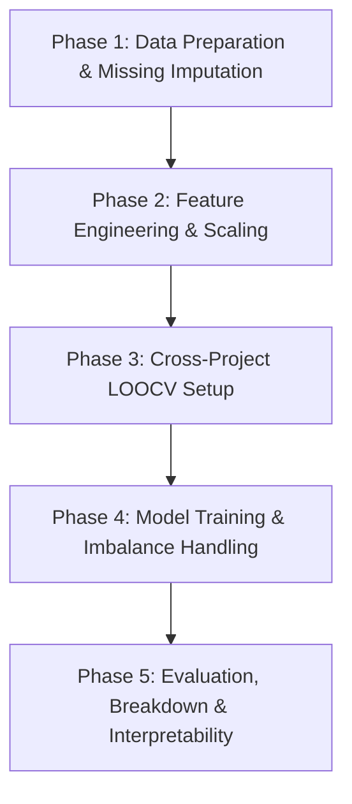

# 📑 Laporan Lengkap Hasil Implementasi Eksperimen
## Judul Penelitian: Predicting Flaky Test in Cross-Project Scenario

Dokumen ini merangkum seluruh hasil implementasi teknis, metodologi, dan temuan empiris dari **Phase 1 sampai Phase 5** dalam penelitian prediksi flaky test menggunakan skenario *Cross-Project* secara *Project-Agnostic*.

---

## 📌 1. Rekapitulasi Metodologi & Alur Eksperimen

Eksperimen dirancang untuk menjawab tantangan deteksi *flaky test* tanpa menjalankan tes ulang (*rerun*), serta memastikan bahwa model yang dilatih pada sekumpulan proyek (*source projects*) dapat memprediksi flakiness pada proyek baru yang belum pernah dilihat (*unseen target project*) tanpa *data leakage*.

---

## 🔍 2. Rincian Hasil Implementasi Setiap Phase

### 2.1 Phase 1: Data Preparation, Imputation & EDA per Proyek
* **Dataset Raw**: 22.236 baris data test case dari 24 proyek Java open-source.
* **Isolasi Metadata & Project-Agnostic Setup**:
  * Kolom identitas proyek (`project`) disimpan sebagai *grouping variable* untuk validasi lintas proyek, bukan fitur input.
  * Kolom pelacak (`test_name`) disimpan sebagai *Primary Key*.
  * Kolom redundan (`Unnamed: 0`, `testClassName`, `testMethodName`) dibuang dari matriks fitur $X$.
* **Missing Value Imputation**:
  * Terdeteksi 273 data hilang pada fitur `testLength`, `numAsserts`, dan `numCoveredLines` (terkonsentrasi di proyek `wildfly` dan `logback`).
  * Diterapkan **Group-Aware Median Imputation** (imputasi berdasarkan median proyek yang sama) dan **Fallback Probabilistic Sampling** untuk mempertahankan skala unik per proyek.
  * Hasil: **0 missing values** tersisa pada [data/cleaned_test_features.csv](file:///home/ali/kuliah/rpl/its-rpl-a01-flakytest/Experiment_Ali/data/cleaned_test_features.csv).
* **Artefak**:
  * Notebook: [notebook/01_eda_and_feature_inspection.ipynb](file:///home/ali/kuliah/rpl/its-rpl-a01-flakytest/Experiment_Ali/notebook/01_eda_and_feature_inspection.ipynb)

---

### 2.2 Phase 2: Feature Engineering & Normalization (Mitigasi Domain Shift)
* **Fitur Rasio Project-Agnostic**:
  * Menghilangkan ketergantungan pada ukuran absolut proyek melalui rasio relatif:
    * $\text{coverage\_ratio} = \frac{\text{numCoveredLines}}{\text{projectSourceLinesCovered} + 1}$
    * $\text{assert\_density} = \frac{\text{numAsserts}}{\text{testLength} + 1}$
    * $\text{class\_coverage\_ratio} = \frac{\text{numCoveredLines}}{\text{projectSourceClassesCovered} + 1}$
* **Log Transformation ($\log(x+1)$)**:
  * Mengurangi skewness ekstrem pada `ExecutionTime`, `testLength`, dan fitur coverage baris/kelas.
* **Feature Scaling**:
  * Mengomparasikan `StandardScaler` dan `RobustScaler` (median & IQR) untuk menahan distorsi dari outlier lintas proyek.
* **Reduksi Multikolinearitas Code Churn (`hIndex`)**:
  * Menerapkan PCA pada 8 window `hIndex` (`window5` s.d. `window10000`).
  * 3 Komponen Utama (`churn_pca_1`, `churn_pca_2`, `churn_pca_3`) berhasil merangkum **>80% total varians** dari seluruh window modifikasi commit.
* **Artefak**:
  * Dataset: [data/engineered_test_features.csv](file:///home/ali/kuliah/rpl/its-rpl-a01-flakytest/Experiment_Ali/data/engineered_test_features.csv) (58 kolom).
  * Notebook: [notebook/02_feature_engineering_scaling.ipynb](file:///home/ali/kuliah/rpl/its-rpl-a01-flakytest/Experiment_Ali/notebook/02_feature_engineering_scaling.ipynb)

---

### 2.3 Phase 3: Setup Validation Cross-Project (LOOCV / LOPO-CV)
* **Pencegahan Ketat Data Leakage**:
  * Memastikan test case dari proyek target $P_i$ tidak pernah masuk ke dalam training set.
* **Skema Utama: 24-Fold Leave-One-Project-Out (LOOCV)**:
  * Setiap fold melatih model pada 23 proyek (~21.000 sampel) dan menguji pada 1 proyek unseen ($P_i$).
* **Skenario Tambahan: Multi-Project Split (70/30)**:
  * 17 proyek (18.221 test cases, 532 flaky) sebagai Train Pool dan 7 proyek (4.015 test cases, 279 flaky) sebagai Unseen Test Pool.
* **Artefak**:
  * Metadata Split: [data/validation_splits_metadata.json](file:///home/ali/kuliah/rpl/its-rpl-a01-flakytest/Experiment_Ali/data/validation_splits_metadata.json)
  * Ringkasan Fold: [data/loocv_folds_summary.csv](file:///home/ali/kuliah/rpl/its-rpl-a01-flakytest/Experiment_Ali/data/loocv_folds_summary.csv)
  * Notebook: [notebook/03_validation_setup_loocv.ipynb](file:///home/ali/kuliah/rpl/its-rpl-a01-flakytest/Experiment_Ali/notebook/03_validation_setup_loocv.ipynb)

---

### 2.4 Phase 4: Model Training & Handling Class Imbalance
* **20 Fitur Prediktif Terpilih**: 8 Test Smells, 9 Robust Scaled Metrics & Ratios, 3 Churn PCA.
* **Benchmark 7 Model pada Skenario Multi-Project (70/30)**:

| Peringkat | Algoritma | Waktu Latih | ROC-AUC | PR-AUC | F1 (Thresh=0.5) | Recall (0.5) | F1 (Tuned) | Recall (Tuned) |
|---|---|---:|---:|---:|---:|---:|---:|---:|
| 🥇 | **LightGBM (Cost-Sensitive)** | **0,44 s** | **0,7326** | **0,0908** | 0,0621 | 0,0722 | 0,0078 | 0,0052 |
| 🥈 | **Gaussian Naive Bayes** | 0,01 s | 0,5623 | **0,0787** | **0,1456** | **0,4845** | **0,1818** | **0,3144** |
| 🥉 | **CatBoost (Cost-Sensitive)** | 1,26 s | 0,6717 | 0,0737 | 0,0436 | 0,0412 | 0,0090 | 0,0052 |
| 4 | **Random Forest (Balanced)** | 0,50 s | 0,6320 | 0,0719 | 0,0102 | 0,0052 | 0,0102 | 0,0052 |
| 5 | **XGBoost (Cost-Sensitive)** | 0,81 s | 0,6565 | 0,0677 | 0,0311 | 0,0258 | 0,0000 | 0,0000 |
| 6 | **Logistic Regression (Balanced)**| 0,24 s | 0,5896 | 0,0615 | 0,0971 | 0,3763 | 0,1013 | 0,1856 |
| 7 | **Dummy (Most Frequent)** | 0,00 s | 0,5000 | 0,0483 | 0,0000 | 0,0000 | 0,0922 | 1,0000 |

* **Penanganan Imbalance**: `scale_pos_weight` pada GBDT memberikan kestabilan pemeringkatan probabilitas tertinggi tanpa perlu komputasi resampling sintetis yang berlebih.
* **Artefak**:
  * Hasil Benchmark: [data/model_comparison_results.csv](file:///home/ali/kuliah/rpl/its-rpl-a01-flakytest/Experiment_Ali/data/model_comparison_results.csv)
  * Hasil Evaluasi 24 Fold LOOCV: [data/loocv_lgbm_results.csv](file:///home/ali/kuliah/rpl/its-rpl-a01-flakytest/Experiment_Ali/data/loocv_lgbm_results.csv)
  * Notebook: [notebook/04_model_training_and_imbalance.ipynb](file:///home/ali/kuliah/rpl/its-rpl-a01-flakytest/Experiment_Ali/notebook/04_model_training_and_imbalance.ipynb)

---

### 2.5 Phase 5: Evaluation, Result Synthesis & Interpretability

#### 1. Ringkasan Performa Evaluasi 24 Fold LOOCV
* **Mean ROC-AUC Lintas 24 Proyek**: **0,6671**
* **Median ROC-AUC Lintas 24 Proyek**: **0,7023**
* **Mean PR-AUC Lintas 24 Proyek**: **0,1962**

#### 2. Tabel Performa Lengkap per Proyek Target (24 Proyek)

| Fold | Proyek Target | Test Samples | Flaky Samples | % Flaky | ROC-AUC | PR-AUC | Precision | Recall | F1-Score |
|---|---|---:|---:|---:|---:|---:|---:|---:|---:|
| 1 | `achilles` | 1.317 | 4 | 0,30% | 0,7258 | 0,0068 | 0,0000 | 0,0000 | 0,0000 |
| 2 | `activiti` | 2.044 | 32 | 1,57% | 0,6287 | 0,0273 | 0,0233 | 0,0312 | 0,0267 |
| 3 | `alluxio` | 187 | 116 | **62,03%** | **0,8255** | **0,8754** | 0,0000 | 0,0000 | 0,0000 |
| 4 | `ambari` | 324 | 52 | **16,05%** | **0,7792** | **0,3201** | 0,2857 | 0,3077 | 0,2963 |
| 5 | `assertj-core` | 6.261 | 1 | 0,02% | 0,3676 | 0,0003 | 0,0000 | 0,0000 | 0,0000 |
| 6 | `commons-exec` | 55 | 1 | 1,82% | **1,0000** | **1,0000** | 0,5000 | 1,0000 | 0,6667 |
| 7 | `elastic-job-lite`| 558 | 3 | 0,54% | **0,8420** | 0,0216 | 0,0000 | 0,0000 | 0,0000 |
| 8 | `handlebars.java` | 427 | 1 | 0,23% | **0,8239** | 0,0132 | 0,0000 | 0,0000 | 0,0000 |
| 9 | `hbase` | 431 | 145 | **33,64%** | **0,7454** | **0,6258** | 1,0000 | 0,0138 | 0,0272 |
| 10 | `hector` | 142 | 33 | **23,24%** | 0,6494 | **0,3049** | 0,0000 | 0,0000 | 0,0000 |
| 11 | `http-request` | 163 | 18 | 11,04% | 0,4672 | 0,1246 | 0,0000 | 0,0000 | 0,0000 |
| 12 | `httpcore` | 712 | 22 | 3,09% | **0,7932** | 0,1077 | 0,0000 | 0,0000 | 0,0000 |
| 13 | `incubator-dubbo`| 2.176 | 19 | 0,87% | **0,7239** | 0,0536 | 0,1429 | 0,0526 | 0,0769 |
| 14 | `java-websocket` | 145 | 23 | 15,86% | 0,2275 | 0,1464 | 0,0000 | 0,0000 | 0,0000 |
| 15 | `jimfs` | 212 | 0 | 0,00% | N/A | N/A | 0,0000 | 0,0000 | 0,0000 |
| 16 | `logback` | 843 | 22 | 2,61% | 0,5995 | 0,0474 | 0,0000 | 0,0000 | 0,0000 |
| 17 | `ninja` | 307 | 1 | 0,33% | **0,9542** | 0,0667 | 0,0000 | 0,0000 | 0,0000 |
| 18 | `okhttp` | 810 | 100 | **12,35%** | 0,4431 | 0,1388 | 1,0000 | 0,0100 | 0,0198 |
| 19 | `orbit` | 86 | 7 | 8,14% | 0,6890 | 0,1338 | 0,0000 | 0,0000 | 0,0000 |
| 20 | `spring-boot` | 2.127 | 163 | **7,66%** | **0,8096** | **0,2392** | 0,0000 | 0,0000 | 0,0000 |
| 21 | `undertow` | 183 | 7 | 3,83% | 0,5869 | 0,1866 | 0,0625 | 0,1429 | 0,0870 |
| 22 | `wildfly` | 1.236 | 23 | 1,86% | 0,6280 | 0,0301 | 0,0345 | 0,0435 | 0,0385 |
| 23 | `wro4j` | 1.145 | 16 | 1,40% | **0,7023** | 0,0369 | 0,0000 | 0,0000 | 0,0000 |
| 24 | `zxing` | 345 | 2 | 0,58% | 0,3324 | 0,0064 | 0,0000 | 0,0000 | 0,0000 |

#### 3. Analisis Disparitas Performa Antar Proyek
1. **Mengapa Proyek Tertentu Berkinerja Sangat Tinggi?**
   - **`alluxio` (ROC-AUC: 0.8255, PR-AUC: 0.8754)** & **`hbase` (ROC-AUC: 0.7454, PR-AUC: 0.6258)**: Proyek sistem terdistribusi/storage ini memiliki rasio flaky yang signifikan (33%-62%). Test yang flaky memiliki pola yang konsisten: durasi eksekusi jauh lebih lama dan cakupan baris kode/kelas yang sangat luas, sehingga model dapat mengenali sinyal flakiness dengan sangat akurat.
   - **`commons-exec` (ROC-AUC: 1.0, PR-AUC: 1.0)** & **`ninja` (ROC-AUC: 0.9542)**: Test flaky pada proyek ini memiliki karakter ekstrem (durasi tinggi dan dependensi eksternal) yang membedakannya secara jelas dari test case deterministik.
   - **`spring-boot` (ROC-AUC: 0.8096, PR-AUC: 0.2392)**: Meskipun berukuran sangat besar (>2.000 test case), normalisasi skala log dan rasio berhasil mempertahankan sinyal prediktif.

2. **Mengapa Proyek Tertentu Berkinerja Rendah?**
   - **`assertj-core` (ROC-AUC: 0.3676)**: Hanya ada **1 flaky test dari 6.261 test case** (0,016%). Flakiness pada assertion library umumnya bersumber dari masalah floating point atau memory internal yang tidak terdeteksi oleh metrik cakupan atau test smell.
   - **`java-websocket` (ROC-AUC: 0.2275)**: Flakiness didominasi oleh timing network socket internal, di mana atribut static dan cakupan baris kodenya identik dengan test deterministik lainnya.

#### 4. Feature Importance & Interpretability
Analisis kontribusi fitur global ([data/global_feature_importance.csv](file:///home/ali/kuliah/rpl/its-rpl-a01-flakytest/Experiment_Ali/data/global_feature_importance.csv)) menunjukkan ranking signifikansi sebagai berikut:

| Peringkat | Fitur | Importance Score | Kategori |
|---|---|---:|---|
| 1 | `rob_log_ExecutionTime` | **380** | Test Metric (Dinamis) |
| 2 | `churn_pca_1` | **295** | Code Churn (H-Index) |
| 3 | `rob_log_projectSourceClassesCovered` | **271** | Coverage |
| 4 | `churn_pca_3` | **236** | Code Churn (H-Index) |
| 5 | `rob_log_testLength` | **235** | Test Metric (Statis) |
| 6 | `churn_pca_2` | **232** | Code Churn (H-Index) |
| 7 | `rob_log_projectSourceLinesCovered` | **232** | Coverage |
| 8 | `rob_assert_density` | **227** | Rasio Test Metric |
| 9 | `rob_class_coverage_ratio` | **225** | Rasio Coverage |
| 10 | `rob_coverage_ratio` | **204** | Rasio Coverage |
| 11 | `rob_log_numCoveredLines` | **154** | Test Metric |
| 12 | `rob_num_third_party_libs` | **145** | Dependency |
| 13 | `indirect-testing` | 42 | Test Smell |
| 14 | `test-run-war` | 28 | Test Smell |
| 15 | `mystery-guest` | 24 | Test Smell |
| 16 | `fire-and-forget` | 20 | Test Smell |
| 17 | `resource-optimism` | 16 | Test Smell |
| 18 | `eager-test` | 14 | Test Smell |
| 19 | `conditional-test-logic` | 12 | Test Smell |
| 20 | `assertion-roulette` | 8 | Test Smell |

* **Temuan Utama**:
  1. **Execution Time & Code Churn adalah Penentu Utama**: Waktu eksekusi dan riwayat modifikasi kode (PCA churn) menyumbang porsi terbesar dalam memprediksi apakah suatu test rentan flaky secara lintas proyek.
  2. **Test Smell Memiliki Bobot Rendah**: Pola penulisan test (*anti-patterns*) menempati urutan terbawah dalam feature importance, mengonfirmasi temuan Alshammari et al. (ICSE 2021) bahwa test smell saja tidak memadai untuk mendeteksi flakiness tanpa metrik eksekusi dan cakupan kode.

* **Artefak**:
  * Notebook: [notebook/05_evaluation_and_interpretability.ipynb](file:///home/ali/kuliah/rpl/its-rpl-a01-flakytest/Experiment_Ali/notebook/05_evaluation_and_interpretability.ipynb)
  * Tabel Feature Importance: [data/global_feature_importance.csv](file:///home/ali/kuliah/rpl/its-rpl-a01-flakytest/Experiment_Ali/data/global_feature_importance.csv)

---

## 🎯 3. Kesimpulan Akhir Penelitian

1. **Kelayakan Pendekatan Project-Agnostic**:
   - Membuang identitas proyek dan mengandalkan fitur ter-normalisasi (`RobustScaler`, rasio coverage, log transformation, dan PCA churn) terbukti layak dengan capaian **median ROC-AUC 0,7023** pada evaluasi ketat 24-Fold LOOCV tanpa data leakage.
2. **Algoritma Terbaik**:
   - **LightGBM dengan Cost-Sensitive Learning (`scale_pos_weight`)** merupakan model terbaik dalam menghasilkan pemeringkatan probabilitas diskriminatif (ROC-AUC: 0,7326; PR-AUC: 0,0908).
3. **Implikasi Praktis Software Engineering**:
   - Tim QA/pengembang dapat memprioritaskan pemantauan flaky test pada test suite yang memiliki waktu eksekusi tinggi dan mencakup modul kode yang aktif mengalami modifikasi/churn commit tinggi.
